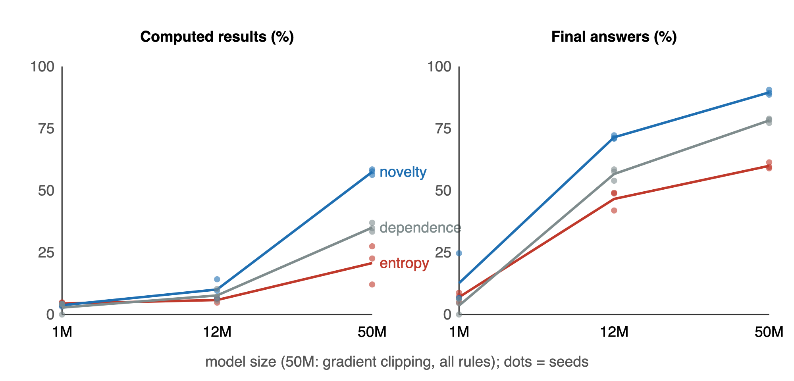
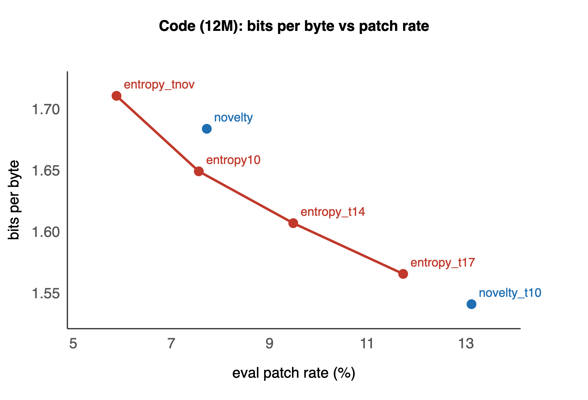

## Abstract

Byte-level language models such as the Byte Latent Transformer (BLT) run their large global model once per patch and start a patch where a small model's next-byte entropy is high. This rule rarely starts a patch at in-line computed results, such as the number after `=` in a worked solution, and accuracy on them collapses under tight patch budgets. We propose *novelty patching*, motivated by LZ77-style compression: start a patch where the upcoming bytes are unlikely to repeat the recent context. The rule is a lookup table over the previous two bytes, fitted in seconds on raw text with no labels, reference model or losses. In BLT-style models trained from scratch on a 1.9 GB math corpus at a matched ~11% patch rate (3 seeds each), it has no clear effect at 1M parameters, raises final-answer accuracy from 47% to 72% at 12M, and at 50M raises computed-result accuracy from 21% to 57% and final-answer accuracy from 60% to 90%; a table fitted on the raw pretraining corpus keeps the gain. Outside math the advantage shrinks: novelty lowers bits per byte on prose and ties entropy on source code and on synthetic execution traces. An analysis of where boundaries fall explains the pattern. Computed results have ordinary surprisal for the patcher's model, so surprisal-seeking rules pass over them: entropy concentrates patch starts on high-surprisal bytes most strongly of all rules (boundary enrichment 1.61) and is the worst on computed results, while the best rules sit near chance enrichment. Novelty works where new content begins at segment starts close to the computation, as in written math; a learned chunker (H-Net) finds such structure on its own, in math and in code. We also report what did not work: typed uncertainty as a training rule, switching rules after training, and a context-aware novelty predictor.

## 1. Introduction

Byte-level models avoid a fixed tokenizer by working on raw bytes and recover efficiency by grouping bytes into variable-length patches [@pagnoni2025blt; @slagle2024spacebyte; @hwang2025hnet]. In BLT [@pagnoni2025blt], a small byte-level language model estimates the entropy of each next byte, a patch starts where that entropy crosses a threshold, and the large global transformer runs once per patch. The guiding principle, shared by later work, is that compute should go where prediction is hard: Scratchpad Patching triggers extra global steps by next-byte entropy [@zheng2026scratchpad], and SOMBRERO trains learned chunkers to place boundaries on high-surprisal bytes [@neitemeier2026sombrero].

Earlier work identified a blind spot in this principle [@vera2026easy]. At a computed result, such as the number after `16 - 3 - 4 = `, the next byte is a digit whose value requires computation over context the local model cannot see, yet the byte does not look unusually surprising to the small patcher. Under tight patch budgets, an entropy threshold spends patches on hard-to-predict prose and skips these positions, and accuracy on them collapses. That work proposed *boundary dependence*, a table of how much the model's own loss rises when a patch start is removed, as a label-free fix.

Here we take a different, cheaper route, motivated by compression. An LZ77 compressor [@ziv1977universal] encodes text as copies of earlier substrings plus new literals: copies are cheap, and new literals are where information enters. We ask whether patch boundaries belong where the compressor would stop copying. *Novelty patching* starts a patch where the upcoming bytes are unlikely to repeat the last 128 bytes, predicted from the previous two bytes by a lookup table fitted on raw text in seconds. It needs no labels, no reference model and no losses, and at inference it costs a table lookup.

Our contributions:

1. **A strong, scale-dependent effect in math.** In BLT-style models trained from scratch at 1M, 12M and 50M parameters on the same corpus and patch rate (3 seeds each), novelty patching has no effect at 1M, a clear effect at 12M and a large one at 50M: computed results 57.5% vs 20.7% for entropy, final answers 89.5% vs 59.9%. A table fitted on the raw pretraining corpus keeps the gain (§4).
2. **Scope outside math.** Novelty lowers bits per byte on prose, ties entropy on source code (also on exact token accuracy) and on synthetic execution traces (§5).
3. **Why it works.** Computed results have ordinary surprisal, so surprisal-seeking boundaries miss them: boundary enrichment, the metric SOMBRERO optimizes, is highest for entropy, the rule that is worst on computed results. Novelty succeeds where new content begins at segment starts near the computation; in code and traces it does not. A learned chunker (H-Net) recovers such structure on its own (§6).
4. **Negative results that bound the claim** (§7).

## 2. Related work

**Patching rules.** BLT [@pagnoni2025blt] uses a global entropy threshold (and an approximate monotonic variant); entropy spikes as boundaries go back to dynamic pooling [@nawrot2023dynamic]. SpaceByte [@slagle2024spacebyte] patches at word boundaries; H-Net [@hwang2025hnet], AU-Net [@videau2025aunet], MrT5 [@kallini2024mrt5] and ByteSpan [@goriely2025bytespan] learn or derive boundaries in other ways. Scratchpad Patching [@zheng2026scratchpad] adds entropy-triggered global steps inside fixed patches, Fast BLT [@kallini2026fastblt] speeds up decoding, and EntropyMoE [@liu2026entropymoe] routes patches to experts by entropy. Haltiuk [@haltiuk2026disentangling] argues that the boundary distribution can be changed nearly independently of language modeling. The BLT code base also contains an unused patcher that decides patch starts from a lookup table indexed by the previous two tokens (`bytelatent/data/patcher.py`, present since the initial release); no table, configuration or results for it are released, and the BLT paper does not describe it. The mechanism is the same as ours; what we add is the table's content (the novelty target), the motivation, and the evidence.

**Boundaries and surprisal.** SOMBRERO [@neitemeier2026sombrero] defines *boundary enrichment*, the mean surprisal at chunk starts relative to all bytes, and trains a hierarchical byte model to raise it; it reports bits per byte (including math and code) and log-likelihood downstream tasks at 1B scale, but not accuracy on computed values. ByteFlow [@deng2026byteflow] selects boundaries by the marginal coding-rate gain of the encoder's latent states, a learned, latent notion of new information, and reports that it beats an entropy criterion inside its architecture on bits per byte and commonsense tasks. Our results are consistent with ByteFlow's direction and quantify it on answer accuracy.

**Compression and segmentation.** Compression and prediction are two sides of the same coin [@deletang2024language]. Description-length criteria segment text into words without supervision [@kit1999unsupervised]. zip2zip [@geng2025zip2zip] uses LZW at inference to merge recurring tokens into hypertokens, which shortens sequences; we use the LZ notion of reuse for a different purpose, deciding where a model spends global compute.

**Prior work.** Vera Zúñiga [@vera2026easy] documented the blind spot of entropy patching on BLT-1B and in models trained from scratch, and proposed boundary dependence; we reuse its training pipeline, corpus and evaluation, and report its dependence rule as a baseline.

## 3. Method and setup

**Novelty.** For a byte stream $b$, let $m_t$ be the length of the longest prefix of $b_{t:}$ that also starts within the previous 128 bytes (capped at 16). Novelty is $-m_t$: high when the upcoming bytes do not repeat recent context. Novelty depends on future bytes, so it cannot be used directly; we predict it causally. The novelty table averages $-m_t$ over each preceding two-byte context $(b_{t-2}, b_{t-1})$ in a 4 MB sample of training text (falling back to one byte, then the global mean, for contexts seen fewer than 20 times). A patch starts at $t$ when the table value exceeds a threshold set on training text for a target rate. Fitting takes seconds on a CPU; applying it is a lookup per byte. We fit two tables: **nov**, on GSM8K and MATH training solutions (as in the earlier dependence table), and **novc**, on 4 MB sampled from the raw pretraining corpus, with no math-specific selection.

**Baselines.** *Entropy*: BLT's global threshold on the next-byte entropy of a small byte language model (32 dimensions, one layer) trained on the corpus. *Dependence*: the boundary-dependence table of [@vera2026easy] (the loss increase when a patch start is removed, per two-byte context). *Syntax + entropy*: a hand-written rule that starts a patch after every math-syntax marker (`=`, `\boxed{`, `#### `, `>>`) and fills the rest of the budget by entropy.

**Models and data.** BLT-style models (cross-attention pooling, windowed local decoder, 128-byte context) at three sizes: 1M (width 128, 4 global layers, 131M training bytes), 12M (320, 8 layers, 0.5B bytes) and 50M (576, 12 layers, 1.5B bytes), all trained from scratch on the same 1.9 GB corpus (OpenWebMath [@paster2024openwebmath] shards plus GSM8K [@cobbe2021gsm8k] and MATH [@hendrycks2021math] training solutions repeated to 10% of bytes; SHA-256 pinned; documents overlapping the evaluation set removed). Each rule's threshold targets 10% of training bytes (13% for novc), which gives 10.9–12.1% of evaluation bytes (entropy 11.2%, dependence 10.9%, novelty 11.9%, corpus-fitted novelty 11.4%). At 50M all runs use gradient clipping at norm 1.0, which we checked to be neutral for the baselines (entropy without clipping: final answers 59.0% vs 59.9% with it).

**Evaluation.** On held-out GSM8K and MATH solutions: exact match of greedy decoding given the true prefix, with patch boundaries decided online from the bytes seen so far, for 1000 in-line computed results (the value after `=` in GSM8K's calculator annotations) and 660 final answers (after `#### `), plus bits per byte. Three seeds per configuration; we report means ± standard deviation over seeds.

## 4. Results in math

{{table:paper_math}}

Table 1 shows the main result. At 1M every rule is near the floor on computed results (3–5%), and only the hand-written rule lifts final answers (one dependence seed diverged at 1M, hence its bits per byte). At 12M novelty raises final answers by 25 points over entropy (71.5% vs 46.6%; every seed separates) and over the dependence table (56.7%), and computed results from 5.8% to 10.1%. At 50M the gap is large on both targets: computed results 57.5% vs 20.7% (entropy) and 35.1% (dependence), final answers 89.5% vs 59.9% and 78.2%. Entropy's computed accuracy varies widely across seeds (12.1, 27.5 and 22.6%), but its best seed is far below novelty's worst (56.3%). The effect grows with model size (Figure 1): no difference at 1M, a 25-point final-answer gain at 12M, and 30 points on final answers and 37 on computed results at 50M.

{width=95%}

**The corpus-fitted table keeps the gain.** Fitted on the raw pretraining corpus, novelty matches the solution-fitted table on computed results (57.3% vs 57.5% at 50M) and is 3 points lower on final answers (86.4% vs 89.5%; seed ranges do not overlap), with better bits per byte. The rule does not depend on curated math examples.

**Cost in bits per byte.** Novelty costs a little overall bits per byte at 50M (1.446 vs 1.416 for entropy), consistent with spending patches on math structure rather than on hard prose bytes; the corpus-fitted table narrows the gap (1.436), and at 12M it has the best bits per byte of all rules (1.619).

## 5. Beyond math

We repeat the comparison at 12M on three other domains (2 seeds each): prose (WikiText-103), Python source code (the standard library and installed packages, 600 MB, held out by file), and synthetic execution traces (straight-line programs that print each assigned value after `->`, 300 MB). In each domain both rules are fitted on that domain's training text, and novelty's threshold is set so its evaluation patch rate matches entropy's.

{{table:paper_outside}}

**Prose.** Novelty lowers bits per byte (1.770 vs 1.832 at a 10% rate), on both new and copied bytes.

**Code.** At a matched evaluation rate (7.7% vs 7.6%) entropy has lower bits per byte (1.649 vs 1.684). Entropy's curve over four budgets (Figure 2) passes through novelty's higher-budget point (13.1%: 1.541), so at equal inference cost the rules are tied or entropy is slightly ahead; at an equal training budget novelty is better, because on held-out code it starts more patches than on training code. Exact match of whole tokens at the matched rate shows no hidden accuracy gain (Table 3): novelty is slightly better on identifiers that did not occur in the previous 128 bytes (+0.9 ± 0.1 points) and slightly worse on copied values after `=`, `return` or `(` (−1.8 ± 0.5); other differences are within noise.

{width=60%}

{{table:paper_codeacc}}

**Execution traces.** Computed values (`d = c * 2 -> 44`) and copied values (`c = b -> 22`) can be scored separately. At a matched 10% rate the rules tie on computed values (entropy 55.1%, novelty 50.2%; entropy's seeds differ by 12 points) and novelty is better on copied values (61.0% vs 56.9%). Neither rule starts patches at the values: entropy spends its budget on operands (82% covered) and literals, novelty on line starts (100%), and both cover 0% of computed values (§6).

## 6. Why novelty works where it does

**Computed results are not surprising to the patcher.** We compute the boundary enrichment of SOMBRERO [@neitemeier2026sombrero], $B$ = mean surprisal at patch starts / mean surprisal over all bytes, with surprisal from the same small byte model that drives entropy patching, on the math evaluation set at the exact thresholds of the 50M runs (Table 4). Entropy has the highest enrichment ($B = 1.61$, $Z = 215$ against a rate-matched circular-shift null) and starts a patch at 1% of computed results; novelty sits close to chance ($B = 1.13$; corpus-fitted 1.03) and covers 99–100% of them. The mean surprisal at computed-result starts is 3.34 bits, close to the 3.12-bit average over all bytes: these positions are not hard for the patcher's model, so a rule that seeks surprisal passes over them. High enrichment goes with the worst computed accuracy.

{{table:paper_enrichment}}

**Novelty finds segment starts in math, not in code.** In math, the novelty table's strongest contexts are a word followed by `?`, the end of a question where a solution begins, and it starts a patch at 75% of line starts (10% of its boundaries, against 1% by chance). In code it starts a patch at none of the statement starts and none of the values after `=`, `return` or `(`; 57% of its boundaries fall inside identifiers (50% by chance), mostly in hex and escape literals: content that is genuinely unrepeated but carries no structure. The limitation is in the target, not only in the two-byte predictor: even the true novelty target covers only 18% of statement starts in code, and a 128-byte network that predicts the target better (rank correlation 0.52 vs 0.39) covers 9%.

**A learned chunker finds the structure on its own.** H-Net [@hwang2025hnet], whose chunk boundaries are learned end to end from the language-modeling loss, has no blind spot on GSM8K: at its native rates, its outer chunks start at the `=` before 100% of in-line computed results and at 100% of final answers [@vera2026easy]. On Python source (500 standard-library snippets, public checkpoints), the outer stage of the two-stage model (26% chunk rate) starts chunks at 45% of statement starts and 35% of values after `=`, `return` or `(` (counting a start at the preceding space), and only 4% inside identifiers. Learned end to end, boundaries recover structure in both domains; novelty is a cheap proxy that coincides with that structure in written math.

**A boundary at the value is not what helps.** On traces, a 128-byte network predicting the same novelty target places patch starts at 74% of computed values and 0% of copied values, far better than the table. Trained with it, the 12M model is worse, not better: computed values 47.9%, copied values 36.6% (vs 50.2% and 61.0% for the table), bits per byte 1.196 (vs 1.157). In the traces, as in math, what the table's boundaries provide is a fresh global state at the start of each segment, not a mark on each result.

## 7. What did not work

{{table:paper_negative}}

**Typed uncertainty as a training rule.** A rule that starts a patch where the patcher is sure of the *kind* of the next byte (digit, letter, punctuation) but unsure of its value fails when used for training at every size (12M final answers 18.9% vs 46.6% for entropy; 50M 35.1% vs 59.9%), with the best bits per byte of all rules. Adding the answer cue (a forced patch after `#### `) rescues final answers at 50M (65.7%) but not computed results (9.5%).

**Switching rules after training.** At inference on BLT-1B, layouts can be changed without retraining: novelty fitted on GSM8K solutions raises computed results from 19.0% to 56.5% at a 10% rate but final answers collapse (51.4% to 19.4%); adding the answer cue gives 54.8% and 65.6%, the best label-free layout we found without retraining. In small models trained from scratch the swap fails completely: a 12M model trained with novelty and evaluated with entropy or typed layouts falls from 73.6% to 0–0.5% on final answers and from 1.66 to 2.5–2.9 bits per byte.

**Learned predictors.** Besides the trace network above, an 8-byte network predicting boundary dependence [@vera2026easy] was below the two-byte table on accuracy, and a 128-byte network on that target was too noisy to learn at our reference-model size (held-out rank correlation 0.03). Combining novelty with entropy (patching where either fires) was worse than either alone in the earlier 1M setup of [@vera2026easy].

## 8. Limitations

**Scale.** Our models are at most 50M parameters trained from scratch, plus inference-only layouts on BLT-1B. The trend from 1M to 50M favours novelty, but the methods we compare against run at 1B and above, where a stronger patcher might find computed results more surprising. A preregistered scale-up (150M models from scratch, and full fine-tuning of BLT-1B with frozen patchers) is designed but not yet run.

**Domain.** The large effect is in written math. Prose shows a modest gain; code and execution traces show ties. Outside math we measure 12M models with two seeds.

**Rule.** The table sees two bytes and a 128-byte lookback; on code it fires on rare literals rather than structure. Context-aware predictors did not help (§6–7).

**Architecture and evaluation.** One architecture family (BLT-style, 128-byte context), one corpus for math, teacher-forced exact match on answer spans; end-to-end generation is at the floor at these sizes.

## 9. Conclusion

Where should a byte-level model spend its global compute? The prevailing answer, where the next byte is hard to predict, misses positions whose value must be computed but whose surprisal is ordinary. A compression view gives a different answer: where the text stops repeating. Implemented as a two-byte lookup table fitted in seconds, it raises computed-result accuracy from 21% to 57% and final-answer accuracy from 60% to 90% in 50M-parameter models on math, with an effect that grows with scale, and it costs nothing at inference. Its reach is limited to text where new content begins at segment starts near the computation; learned chunkers find such structure more generally. The practical message for patcher design is to stop treating surprisal as the target: on math, the rules that concentrate boundaries most on surprising bytes compute worst.

## Code and data

Code, configurations, the corpus recipe (SHA-256), per-run results and the scripts that generate every table and figure are available at <https://github.com/nicoveraz/segresearch> (directory `paper2/` and `scale/`). Compute: an Apple M-series laptop, free Kaggle T4 sessions and a few rented A40 GPUs.

## References
